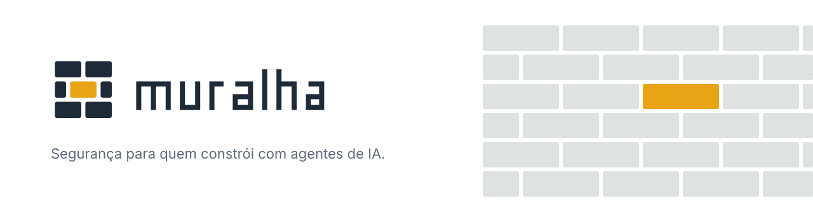
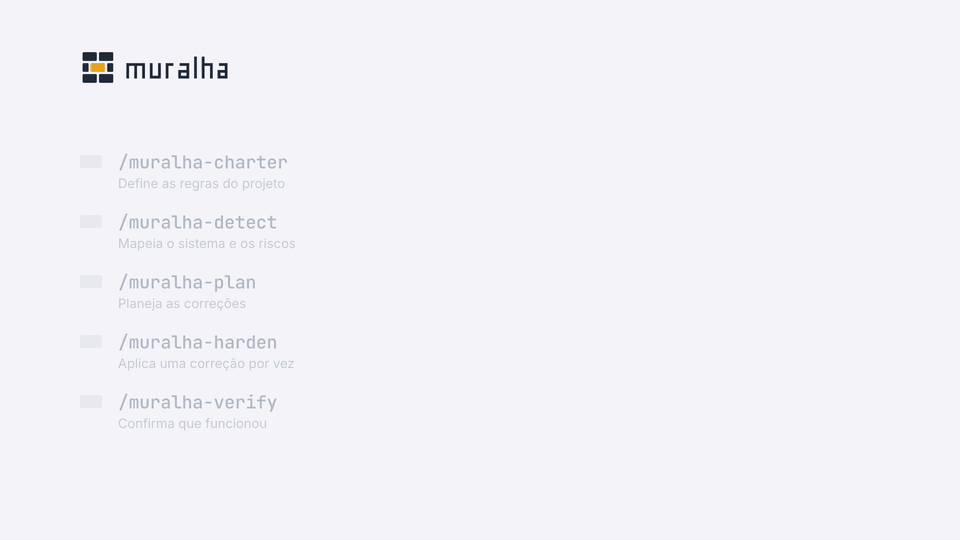

<p align="center"></p>

# Muralha

[](https://www.npmjs.com/package/muralha)
[](https://github.com/thomm-011/muralha/actions/workflows/ci.yml)
[](LICENSE)

Copiloto de segurança para quem desenvolve com agentes de IA. Skills em Markdown + dashboard local, sem chave de API.

## Fluxo

<p align="center"></p>

1. `/muralha-charter`: define as regras de segurança do projeto
2. `/muralha-detect`: mapeia o sistema e registra os riscos
3. `/muralha-plan`: plano de correção
4. `/muralha-harden`: aplica uma correção por vez
5. `/muralha-verify`: confirma que funcionou

`/muralha` constrói funcionalidades já com endurecimento aplicado.

## Instalação e uso

Requer Node.js 20 ou mais novo. Não precisa instalar: o `npx` baixa e roda o [pacote do npm](https://www.npmjs.com/package/muralha).

```bash
npx muralha install   # copia as skills para .claude/skills do projeto atual
npx muralha           # dashboard em http://127.0.0.1:4317
```

Depois de instalar as skills, peça ao seu agente `/muralha-charter` e siga o fluxo acima.

O estado fica em `.muralha/` (`charter.md`, `findings.json`).

## Desenvolvimento

```bash
npm install && npm test
```

## Relatório nos PRs

`muralha report` lê `.muralha/findings.json` e gera um resumo, sem IA nem chave de API. Serve para o CI mostrar o estado da segurança em cada PR.

```bash
npx muralha report                         # resumo em Markdown
npx muralha report --format annotations    # comandos de anotação do GitHub Actions
npx muralha report --fail-on high          # sai com código 1 se houver achado pendente
                                           # (aberto ou planejado) high ou critical
```

Em outro projeto, use o pacote publicado no lugar do build local, de preferência com a versão fixada: `npx --yes muralha@0.1.1 report --fail-on high`.

Este repositório traz um workflow pronto em `.github/workflows/muralha-report.yml`: ele comenta no PR (atualizando sempre o mesmo comentário), anota os arquivos e reprova o check se houver achado grave pendente. A tabela e o dashboard mostram a categoria OWASP de cada achado (campo `category`, como `A01:2025` ou `LLM06:2025`). O comentário só é feito em PRs de branches do próprio repositório, porque em PRs de forks o token do GitHub é somente leitura.

## Instalação como plugin

```bash
# Claude Code
claude plugin marketplace add thomm-011/muralha
claude plugin install muralha@muralha
```

Manifests para Codex e Cursor ficam em `.codex-plugin/` e `.cursor-plugin/`.
